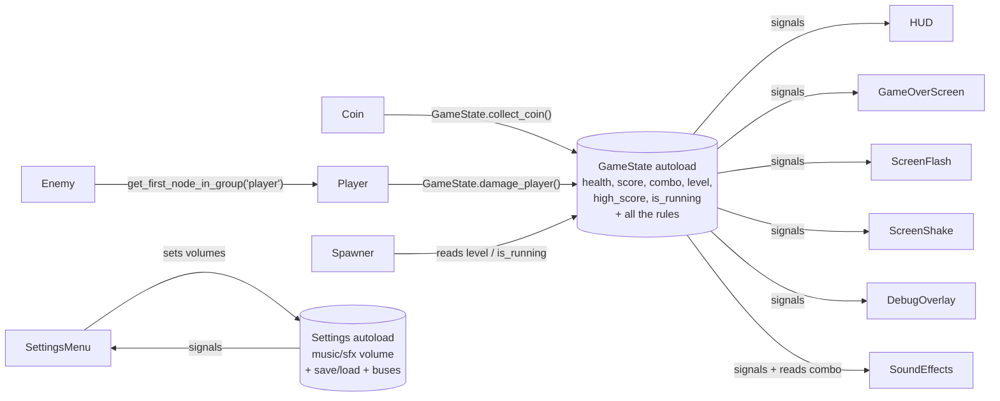
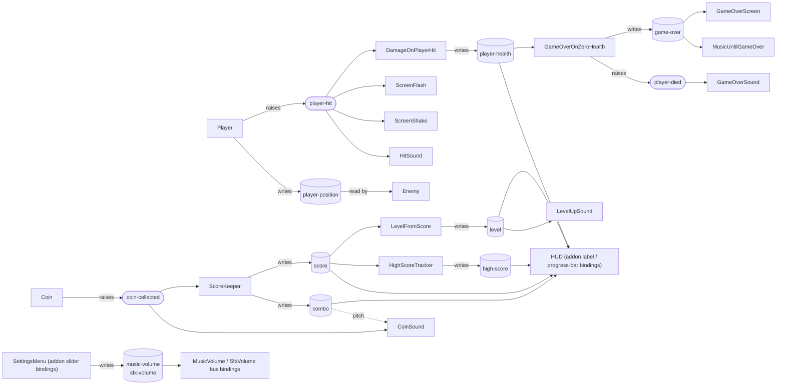

# Coin Rush — Classic Godot vs. Godot MEDS

The same small arcade game implemented twice, so the **only** difference between the two projects is the architecture:

| Folder | Approach |
| --- | --- |
| [classic-game/](./classic-game/) | Idiomatic Godot: a `GameState` **autoload singleton** owns all shared state and rules, nodes talk to it through signals and direct calls. |
| [meds-game/](./meds-game/) | [Godot MEDS](https://github.com/joranmarcy/Godot-MEDS-Sample): shared state lives in **Resource variables** (`.tres`), communication goes through **Resource events**, and each rule is a tiny node. |

Gameplay, visuals, tuning values and scene layout are identical; most scripts (player, coin, enemy, spawner, arena…) are line-for-line equivalent apart from *where they read and write state*.

## The game

Move the blue orb with **WASD / arrow keys**, a **gamepad**, or on a phone by **dragging anywhere** on the screen (floating virtual joystick). Collect gold coins and dodge the red enemies.

- Each coin gives `10 × combo`. The combo grows with each coin and resets after 2 s without a pickup.
- Every 200 points the level increases: enemies spawn faster and move faster.
- Touching an enemy costs 1 health (then 1 s of invulnerability). At 0 health the game is over.
- The best score is saved to disk. Press **Restart** (or Enter) on the game-over screen to play again.
- Sounds for coins (pitch rises with the combo), hits, level-ups and game over, plus a looping music track.
- **Esc**, gamepad **Start** or the on-screen **II** button pauses and opens the volume settings (separate **Music** and **Sound effects** sliders, saved to disk).
- **F1**, or the **Debug overlay** button in the pause menu, toggles an in-game debug overlay.

## Running

Requires **Godot 4.6** (MEDS also supports 4.5). Open either `project.godot` from the Godot project manager and press **F5**.

Both projects ship the same gameplay test (physics pickup/contact, combo scoring, levels, game over, restart reset, sounds, volume settings, pause menu, touch joystick and on-screen buttons):

```powershell
cd classic-game   # or meds-game
godot --path . -s res://tests/test_gameplay.gd             # full run (opens a window briefly)
godot --headless --path . -s res://tests/test_gameplay.gd  # no window; touch checks are skipped
```

Touch checks need a display: headless Godot never delivers events sent with `Input.parse_input_event()`, which is how the test simulates fingers.

The sounds are generated, not downloaded. To change them, edit [tools/generate_sounds.py](./tools/generate_sounds.py) and run `python tools/generate_sounds.py`; it writes identical files into both projects.

## Phones and touch

Both games are set up for phones and tablets in the same way:

- **Touch controls:** [virtual_joystick.gd](./meds-game/game/scripts/virtual_joystick.gd), a full-screen floating joystick (in `touch_controls.tscn`). It presses the same `move_*` input actions as the keyboard and gamepad, with analog strength, so the player script doesn't know touch exists. Buttons and menus drawn above it take their taps first.
- **On-screen buttons:** the **II** pause button and the pause menu's **Resume** / **Debug overlay** buttons make keyboard-only features usable on phones. Classic uses [action_button.gd](./classic-game/scripts/action_button.gd), which fakes the key press of an input action. MEDS uses [toggle_bool_button.gd](./meds-game/game/scripts/toggle_bool_button.gd), which flips the same `game-paused` / `debug-overlay-visible` variable as the keyboard shortcut.
- **Any screen shape:** the window stretch aspect is `expand`, so the arena fills 20:9 phones and 4:3 tablets instead of showing black bars. The camera is anchored top-left, so the visible area always matches the arena, the arena redraws when the screen size changes, and the player starts in the middle of the screen.
- **Project settings:** landscape orientation (sensor), ETC2/ASTC texture import (required for Android export), and *emulate touch from mouse* so you can test the joystick on desktop by dragging with the mouse.

Input is deliberately **not** turned into MEDS variables. Godot's input actions already decouple input devices from gameplay, and keeping that code identical keeps the comparison about game state. If you wanted to watch or edit the joystick direction in the *Variable Values* panel, a `move-input` `Vector2Variable` written by an input node would be the MEDS way. What input *changes* is a different matter: pausing and showing the debug overlay are state, so in MEDS they are variables (see below).

To build for Android, install the Android export templates and SDK, then add an Android preset under **Project → Export**. On iOS, export from macOS with Xcode.

## Architecture at a glance

### Classic



### MEDS



### Where things live

| Concern | Classic | MEDS |
| --- | --- | --- |
| Health, score, combo, level, high score | Properties of [game_state.gd](./classic-game/scripts/game_state.gd) | One `.tres` each in [game/variables/](./meds-game/game/variables/) |
| Tuning (player speed, enemy speed, coin value, combo window, damage) | `const`s and per-node `@export`s | `.tres` variables, editable in the inspector and **at runtime** |
| Scoring / combo rule | `GameState.collect_coin()` | [score_keeper.gd](./meds-game/game/scripts/score_keeper.gd) node |
| Level rule | Setter of `GameState.score` | [level_from_score.gd](./meds-game/game/scripts/level_from_score.gd) node |
| High score rule + save | Setter of `GameState.score` + `_save_high_score()` | [high_score_tracker.gd](./meds-game/game/scripts/high_score_tracker.gd) + `save_to_device = true` on the resource |
| Damage rule | `GameState.damage_player()` | [damage_on_event.gd](./meds-game/game/scripts/damage_on_event.gd) node |
| Game-over rule | `GameState.damage_player()` → `_end_game()` | [game_over_on_zero_health.gd](./meds-game/game/scripts/game_over_on_zero_health.gd) node |
| Enemy → player position | `get_tree().get_first_node_in_group("player")` | Reads `player-position.tres` |
| HUD | Custom [hud.gd](./classic-game/scripts/hud.gd) (5 signal handlers) | **No custom script**: MEDS `variable-driven-label` / `variable-driven-progress-bar` |
| Game-over screen | Custom script listening to `GameState.game_over` | `bool_to_visibility` on `game-over` + MEDS labels + restart button |
| Session reset on restart | `GameState.start_game()` called from `main.gd` | `ResetSessionVariables` node listing the variables to reset |
| Debug overlay | Hand-written field by field | Generic: takes `Array[BaseVariable]` / `Array[Event]` |
| Game state flags | `GameState.is_running`, plus the engine's `get_tree().paused` | Two independent `BoolVariable`s: `game-over` (the run has ended; gameplay nodes stop, game-over screen shows) and `game-paused` (time is frozen; menu shows). Both are session variables, reset to `false` on restart |
| Pause | `get_tree().paused`, set by [settings_menu.gd](./classic-game/scripts/settings_menu.gd); the menu decides when it opens | `game-paused.tres`: written by [toggle_bool_on_action.gd](./meds-game/game/scripts/toggle_bool_on_action.gd) (Esc / Start) and [toggle_bool_button.gd](./meds-game/game/scripts/toggle_bool_button.gd) (II, Resume); read by [bind_bool_to_tree_paused.gd](./meds-game/game/scripts/bind_bool_to_tree_paused.gd), the menu's `bool_to_visibility` and [focus_while_true.gd](./meds-game/game/scripts/focus_while_true.gd) |
| Debug overlay on/off | Private to the overlay script | `debug-overlay-visible.tres` (`On Application Start`, so it stays open across restarts) |
| Sounds | [sound_effects.gd](./classic-game/scripts/sound_effects.gd) connects to 4 `GameState` signals and reads `GameState.combo` | Reusable players: [play_sound_on_event.gd](./meds-game/game/scripts/play_sound_on_event.gd), [play_sound_on_increase.gd](./meds-game/game/scripts/play_sound_on_increase.gd), [play_while_bool.gd](./meds-game/game/scripts/play_while_bool.gd), wired to events/variables in [audio.tscn](./meds-game/game/scenes/audio.tscn) |
| Volume settings | Second autoload, [settings.gd](./classic-game/scripts/settings.gd): one property + signal + save/load code per setting; [settings_menu.gd](./classic-game/scripts/settings_menu.gd) wires each slider both ways | `music-volume.tres` / `sfx-volume.tres` (`save_to_device`), MEDS `variable-driven-slider`, [bind_float_to_bus_volume.gd](./meds-game/game/scripts/bind_float_to_bus_volume.gd) |

## How MEDS improves *understanding*

1. **The scene tree documents the rules.** Open [main.tscn](./meds-game/game/scenes/main.tscn): the `GameRules` node lists every rule of the game (`ScoreKeeper`, `LevelFromScore`, `HighScoreTracker`, `DamageOnPlayerHit`, `GameOverOnZeroHealth`). Select one and the inspector shows exactly which variables/events it reads and writes. In the classic project, the same knowledge is spread inside setters and methods of a single script — e.g. the level and high-score rules are hidden in the `score` setter.
2. **Dependencies are explicit.** A MEDS script can only touch what is assigned to its exports. A classic script can reach `GameState.anything` from anywhere, so you need to read every script to know who depends on what.
3. **Scenes are self-contained.** `player.tscn`, `enemy.tscn`, `hud.tscn` reference resources, not other nodes or an autoload, so each can be opened and run on its own (F6). Enemies no longer need to find the player node.
4. **State has a name and an icon.** Health is `player-health.tres` (an `IntVariable` clamped to 0–5), visible in the FileSystem dock with a MEDS icon, instead of a field inside a 140-line singleton.

## How MEDS improves *debugging* — side-by-side scenarios

### 1. "Who changed the score, and what reacted to it?"

**Classic:** put a breakpoint or `print` in the `score` setter, read the call stack, then search the project for `score_changed` to guess who listens.

**MEDS:** tick **debug_logs** on `score.tres` (in the inspector, or live from the *Variable Values* bottom panel) and collect a coin:

```text
--- Debug: Value Change Detected ---
Resource: res://game/variables/score runtime value changed to: 10
Caller node: /Main/GameRules/ScoreKeeper
Stack trace:
  ...
  at res://addons/godot_meds_core/scripts/variables/int-variable.gd:30 (set_value)
  at res://game/scripts/score_keeper.gd:30 (_on_coin_collected)
  at res://addons/godot_meds_core/scripts/events/event.gd:23 (raise_event)
  at res://game/scripts/coin.gd:25 (_on_body_entered)
- /Main/GameRules/LevelFromScore reacted to value change
- /Main/GameRules/HighScoreTracker reacted to value change
- /Main/HUD/TopBar/Margin/HBox/ScoreLabel reacted to value change
- /Main/GameOverScreen/Root/Center/Panel/Margin/VBox/FinalScoreLabel reacted to value change
- /Main/DebugOverlay reacted to value change
--- End of Debug ---
```

You get the writer, the full causal chain (coin → event → rule → variable) and every listener, with node paths that are clickable in the Output panel. This is why every rule in the MEDS project calls `set_value(new_value, self)`: the `caller` argument is what fills in *Caller node*.

### 2. "Tune the game while playing"

**Classic:** enemy speed is an `@export` on *each enemy instance*; changing it in the Remote tree affects one enemy only, and `COIN_VALUE` / `COMBO_WINDOW` are constants that require a restart.

**MEDS:** open the **Variable Values** bottom panel while the game runs and edit `player-speed`, `enemy-speed`, `coin-value`, `combo-window` or `player-damage`. Every system using the variable picks the new value up immediately. The same goes for `music-volume` / `sfx-volume`: the in-game sliders move as you edit them.

### 3. "Test the game-over flow without playing for 5 minutes"

**Classic:** there is no editor UI to call `GameState.damage_player()`, so you add a temporary debug key. Setting `health` to 0 in the Remote tree updates the HUD (the setter runs) but the game-over screen never appears: the rule lives in `damage_player()`, not in the data.

**MEDS:** in the **Events** bottom panel, raise `player-hit` five times — or set `player-health` to `0` in **Variable Values**. Because the game-over rule *listens to the data*, both paths trigger the real game-over flow, exactly as in gameplay.

The same applies to pausing. In classic, setting `paused` on the SceneTree from the Remote tree freezes the game but the menu doesn't open; the "menu is open" state lives in the menu script. In MEDS, ticking `game-paused` in **Variable Values** pauses the tree, opens the menu and focuses the first slider. Enable `debug_logs` on it and the Output names the node that paused the game: the **II** button, the **Resume** button or the Esc handler.

### 4. "Is it safe to rename or remove this piece of state?"

**Classic:** text-search `GameState.combo` / `combo_changed` and hope nobody used `GameState.get("combo")` or connected by string.

**MEDS:** right-click `combo.tres` in the FileSystem dock → **Log references** to list every scene, script and resource that uses it.

### 5. In-game overlay (works in exported builds)

Press **F1** (or **II** → **Debug overlay** on a phone) in both games. In MEDS you can also tick `debug-overlay-visible` in the **Variable Values** panel, which is handy when the game runs on a phone connected for remote debugging.

- Classic [debug_overlay.gd](./classic-game/scripts/debug_overlay.gd) hard-codes each field and signal; every new piece of state must be added by hand (adding the volume settings meant editing the script and reading a second singleton).
- MEDS [debug_overlay.gd](./meds-game/game/scripts/debug_overlay.gd) knows nothing about the game: it iterates over the variables/events dragged into its arrays, highlights values as they change and timestamps every event raise. It can be dropped into any MEDS project unchanged; the volumes were added by dragging two resources into its array.

## Trade-offs (the honest part)

- **More files.** MEDS adds 16 variable and 3 event resources and several small rule scripts. For a jam-sized game the classic singleton is quicker to write.
- **Wiring lives in the inspector.** Dependencies are in `.tscn` files rather than in code, so plain text search is less useful — which is precisely what the MEDS reference tracking and debug logs compensate for.
- **Resources outlive scenes.** A variable keeps its value while anything references it (including across `reload_current_scene()`), so the start of a session must be explicit — here via the `ResetSessionVariables` node, which must stay first in `main.tscn`. The classic version has the same issue with its autoload (`GameState.start_game()`).
- **Listener order.** Several listeners on the same variable or event run in connection order. Rules that depend on each other (score *then* combo) are kept in one node (`ScoreKeeper`) to stay deterministic. The coin sound reads `combo` for its pitch, so it relies on sitting below `GameRules` in the scene tree (it connects later, so it plays after the combo has been increased).
- **High-frequency variables.** `player-position` changes every physics frame; avoid enabling `debug_logs` on it.
- **Engine state mirrored in a variable.** `game-paused` only stays the source of truth if nothing sets `get_tree().paused` directly. A script that does will desynchronise the menu, the variable and the tree.
- **Saved variables write on every change.** With `save_to_device`, dragging a volume slider rewrites `user://settings.cfg` on each step. The classic `Settings` autoload does the same here, but it could be changed to save once when the menu closes.

## Project structure

```text
tools/generate_sounds.py     generates the .wav files for both projects
classic-game/
  scripts/game_state.gd      autoload: all state + rules
  scripts/settings.gd        autoload: volume settings + save/load
  scripts/*.gd               player, coin, enemy, spawner, hud, game_over_screen, effects, sounds, settings menu, overlay, touch input
  scenes/*.tscn
  sounds/*.wav
  tests/test_gameplay.gd
meds-game/
  addons/godot_meds_core/    MEDS runtime (copied from Godot-MEDS-Sample)
  addons/godot_meds_editor/  MEDS editor tools (docks, reference tracking)
  game/variables/*.tres      shared state, tuning & volume settings
  game/events/*.tres         coin-collected, player-hit, player-died
  game/scripts/*.gd          gameplay nodes + one script per rule + reusable sound/volume bindings + touch input
  game/scenes/*.tscn
  game/sounds/*.wav
  tests/test_gameplay.gd
```
