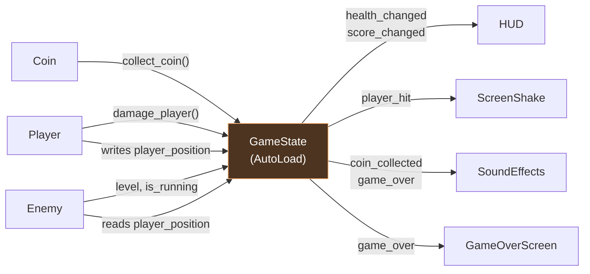
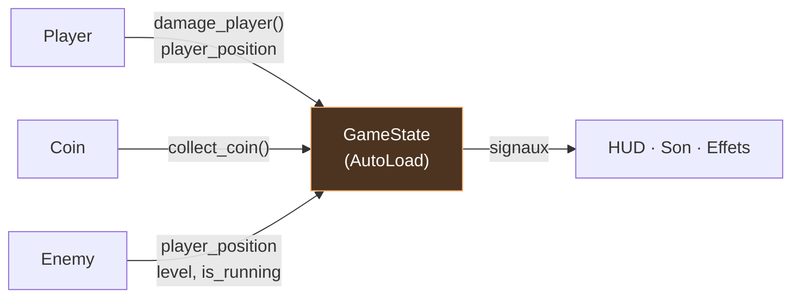

<div class="hero-grid">
  <div class="hero-logo">
    <MedsLogo class="h-72 w-72 rounded-3xl" />
  </div>

  <div class="hero-text">
    <div class="hero-eyebrow">Une architecture modulaire pour</div>
    
    <div class="hero-github-row">
      
      <a class="hero-github" href="https://github.com/joranmarcy" target="_blank">
        <carbon-logo-github /> github.com/joranmarcy
      </a>
    </div>
  </div>
</div>

<div class="hero-event">Capitole du Libre · Novembre 2026</div>

<GodotPlush class="hero-plush" />

<!--
Bonjour à toutes et à tous, et bienvenue dans cette présentation !

Aujourd'hui, je vais vous présenter MEDS, une librairie pour Godot, vous expliquer à quoi elle sert, pourquoi elle a été créée et surtout ce qu'elle peut apporter au développement de jeux et d'applications.

La présentation va durer environ 25 minutes. On va commencer par une petite partie théorique, assez courte, puis on passera rapidement à une démonstration directement dans Godot.

Mais avant ça, je vais me présenter rapidement.
-->

---
layout: two-cols
layoutClass: gap-12
---

# Qui suis-je ?

<v-clicks>

- **Joran Marcy** - Ingénieur R&D logiciel depuis **12+ ans**
- Débuts dans les **logiciels critiques** (contrôle aérien)
- Puis les **technologies immersives** : VR, AR, HoloLens
- **Numix** depuis 6 ans ½ : formations VR, apps mobiles, e-learning
- Moteur principal au quotidien : **Unity**

</v-clicks>

::right::

<div class="h-full flex flex-col justify-center items-center gap-8">
  <figure v-click="4" class="w-full">
    
    <figcaption class="mt-2 text-xs text-center opacity-60">L'agence Numix</figcaption>
  </figure>
  <div v-click="6" class="engine-switch">
    <div class="engine-switch-logos" role="img" aria-label="Unity barré, une flèche vers Godot : mon souhait de remplacer Unity par Godot">
      <div class="engine-switch-unity">
        
        <svg class="engine-switch-strike" viewBox="0 0 100 100" aria-hidden="true">
          <path d="M10 90 L90 10" pathLength="1" />
        </svg>
      </div>
      <svg class="engine-switch-arrow" viewBox="0 0 100 40" aria-hidden="true">
        <path d="M5 20 H90 M74 5 L90 20 L74 35" pathLength="1" />
      </svg>
      
    </div>
    <div class="text-lg opacity-80 text-center">
      Depuis un an, je m'intéresse<br/>
      sérieusement à <span class="godot font-bold">Godot</span>.<br/>
      J'aimerais remplacer Unity par Godot.
    </div>
  </div>
</div>

<!--
Je m'appelle Joran et ça fait un peu plus de 12 ans que je suis ingénieur en développement logiciel.

[click] J'ai commencé ma carrière dans le domaine des logiciels critiques, notamment dans le contrôle aérien.

[click] Puis je me suis assez rapidement orienté vers les technologies immersives, quand j'ai découvert ce qu'il était possible de faire avec les casques de réalité virtuelle et de réalité augmentée, comme le Microsoft HoloLens.

[click] Aujourd'hui, ça fait six ans et demi que je travaille chez Numix, une entreprise spécialisée dans la création de formations en réalité virtuelle, d'applications mobiles et de contenus e-learning.

[click] Chez Numix, on utilise principalement Unity pour développer nos applications. C'est donc le moteur de jeu que je connais le mieux et sur lequel j'ai le plus d'expérience.

[click] Mais depuis quelque temps, je m'intéresse beaucoup à Godot pour remplacer Unity.
-->

---
# Slidev picks the transition from the slide you leave: the plush runs into the "MEDS" section.
transition: plush-run | slide-right
---

# Pourquoi Godot ?

<p class="opacity-70">L'open source, une piste sérieuse pour le développement d'application VR Mobile</p>

<div class="grid grid-cols-3 gap-6 mt-6">
  <div v-click class="card media-card">
    
    <div class="p-5">
      <h3>Maîtrise & transparence</h3>
      <p>Accéder au code source du moteur et comprendre exactement ce qu'il fait. Possibilité de l'adapter pour nos besoins précis.</p>
    </div>
  </div>
  <div v-click class="card media-card">
    <video
      src="/videos/godot-post-process-vr.mp4"
      class="media"
      autoplay
      muted
      loop
      playsinline
    />
    <div class="p-5">
      <h3>3D mobile & VR</h3>
      <p>Renderer Mobile et support OpenXR : assez mature pour de la VR mobile.</p>
    </div>
  </div>
  <div v-click class="card media-card">
    
    <div class="p-5">
      <h3>Indépendance</h3>
      <p>Ne pas dépendre des décisions commerciales d'un éditeur.<br/><em class="opacity-60">cf. la tarification Unity…</em></p>
    </div>
  </div>
</div>

<!--
Pourquoi ? Parce que je pense que l'open source représente une piste particulièrement intéressante pour le développement d'applications 3D temps réel.

[click] D'abord, pour des questions de sécurité et de transparence. Pouvoir accéder au code source d'un moteur, comprendre exactement ce qu'il fait, c'est un vrai avantage.

[click] Ensuite, par curiosité technique. Personnellement, j'aime bien comprendre comment fonctionnent les outils que j'utilise, et ne pas être limité à ce qu'on veut bien me montrer.

[click] Et enfin, pour une question d'indépendance. J'aime bien l'idée de ne pas dépendre des décisions commerciales d'une entreprise qui pourraient, du jour au lendemain, mettre en difficulté un projet, voire une société entière. On a d'ailleurs eu un très bon exemple de ce risque avec les changements de tarification annoncés par Unity.

C'est donc assez naturellement que j'ai commencé à explorer Godot, avec l'envie d'y retrouver certaines pratiques de développement que j'appréciais particulièrement dans Unity. Et c'est comme ça qu'est née la librairie MEDS.
-->

---
layout: section
---

<h1 class="meds-pill-heading">
  <MedsLogo pill-only class="meds-title-pill" />
  <span>MEDS</span>
</h1>

---
layout: center
class: text-center
---

<h1 class="meds-pill-heading">
  <MedsLogo pill-only class="meds-title-pill" />
  <span>MEDS, qu'est-ce que c'est ?</span>
</h1>

<div class="text-xl mt-6 opacity-80">
Une philosophie popularisée par <strong>Ryan Hipple</strong> pour Unity<br/>
<span class="text-base opacity-70">« Game Architecture with Scriptable Objects » — Unite Austin 2017</span>
</div>

<div v-click class="mt-10 text-lg">
  Découverte chez Numix… et coup de <Heart3D />
</div>

<div v-click class="mt-4 text-lg">
  On y retrouve l'<strong>injection de dépendances</strong> et le <strong>découplage</strong>,<br/>
  mais adaptés au développement de jeux vidéo.
</div>

<!--
Alors, MEDS, qu'est-ce que c'est exactement ?

MEDS, c'est un acronyme qui reprend une philosophie de développement popularisée par Ryan Hipple pour Unity.

[click] Cette philosophie, je l'ai découverte en arrivant chez Numix. Et franchement, j'ai trouvé ça génial. Parce qu'elle résolvait pas mal de problèmes qui m'embêtaient dans le développement d'applications Unity.

[click] En venant du monde des logiciels critiques, j'avais notamment pris goût à certains principes d'architecture, comme l'injection de dépendances et le découplage des systèmes. Et avec cette approche, je retrouvais justement une partie de ces principes, mais d'une manière très adaptée au développement de jeux vidéo.

MEDS reprend trois piliers d'ingénierie de cette philosophie.
-->

---

# Trois piliers d'ingénierie

<div class="grid grid-cols-3 gap-6 mt-8">
  <div v-click class="letter-card media-card m-border">
    
    <div>
      <div class="big-letter m">M</div>
      <h3>Modular</h3>
    </div>
  </div>
  <div v-click class="letter-card media-card e-border">
    <video src="/videos/iron-man.mp4" class="media" autoplay muted loop playsinline />
    <div>
      <div class="big-letter e">E</div>
      <h3>Editable</h3>
    </div>
  </div>
  <div v-click class="letter-card media-card d-border">
    
    <div>
      <div class="big-letter d">D</div>
      <h3>Debuggable</h3>
    </div>
  </div>
</div>

<!--
[click] Modular. [click] Editable. [click] Et Debuggable.

On va les voir un par un.
-->

---
layout: two-cols
layoutClass: gap-10
---

# <span class="m">M</span> — Modular

<v-clicks>

- Des systèmes **aussi indépendants que possible**
- Réutiliser un système dans un autre niveau… ou un autre projet
- Lancer **une scène seule**, directement depuis l'éditeur
- Un script = **une responsabilité**

</v-clicks>

<!--
Le premier, c'est Modular, pour modulaire.

[click] L'idée, c'est que les différents systèmes de notre jeu doivent être aussi indépendants que possible. On veut pouvoir les assembler un peu comme des LEGO.

[click] Par exemple, si je développe un système d'ennemis, je veux pouvoir le réutiliser dans un autre niveau, voire dans un autre projet, sans devoir embarquer la moitié de mon jeu avec lui.

[click] Je veux aussi pouvoir lancer une scène toute seule, directement depuis l'éditeur, sans avoir besoin de lancer toute l'application.

[click] Et ça passe aussi par des scripts qui ont des responsabilités bien définies. Un script fait une chose, et il la fait bien.

[click] Pour les développeurs Unity, vous pouvez imaginer les scènes Godot un peu comme des prefabs qu'on pourrait exécuter directement.

[click] L'objectif, c'est d'avoir des systèmes qu'on peut facilement assembler, remplacer, tester et réutiliser.
-->

---

# <span class="e">E</span> — Editable

<div class="grid grid-cols-2 gap-10 mt-6">
<div>

<v-clicks>

- Placer les **données au centre** du développement
- Pas de valeurs codées en dur
- Modifiables **dans l'éditeur**, sans toucher au code
- … et **en temps réel**, pendant que le jeu tourne
- Idéal pour expérimenter et faire du **game design**

</v-clicks>

</div>
<div v-click>

```gdscript
# Avant : valeur codée en dur
var speed: float = 320.0

# Après : donnée partagée et éditable
@export var move_speed: FloatVariable

func _physics_process(_delta):
    velocity = input * move_speed.value
```

</div>
</div>

<!--
Le deuxième principe, c'est Editable, pour éditable.

[click] L'idée, ici, c'est de placer les données au centre du développement.

[click] Plutôt que de coder en dur toutes les valeurs de notre jeu, on va chercher à les rendre facilement modifiables depuis l'extérieur du code. Par exemple, la vitesse d'un personnage, ses points de vie ou encore la couleur d'un élément d'interface.

[click] On veut pouvoir modifier ces données directement dans l'éditeur, sans toucher au code.

[click] Mais on veut aussi pouvoir le faire pendant que le jeu tourne, en temps réel.

[click] Et ça, c'est particulièrement pratique pour ajuster le comportement d'un jeu, expérimenter ou faire du game design.
-->

---

# <span class="d">D</span> — Debuggable

<v-clicks class="mt-8">

- Comprendre **rapidement** ce qui se passe
- Tester chaque système **indépendamment**
- Bug sur les ennemis ? On lance **uniquement** les ennemis

</v-clicks>

<div v-click class="mt-12 text-center text-xl">
  Plus les systèmes sont <strong>isolés</strong>, plus il est facile de comprendre ce qui ne fonctionne pas.
</div>

<!--
Le troisième principe, c'est Debuggable, pour facile à déboguer.

[click] L'objectif, c'est de pouvoir comprendre rapidement ce qui se passe dans notre application,

[click] et surtout de pouvoir tester nos systèmes indépendamment les uns des autres.

[click] Si j'ai un problème avec mes ennemis, je veux pouvoir lancer uniquement mon système d'ennemis, reproduire le problème et le corriger. Je ne veux pas devoir lancer tout le jeu, passer trois menus, charger un niveau et attendre que les bonnes conditions soient réunies pour pouvoir observer mon bug.

[click] Plus les systèmes sont isolés, plus il devient facile de comprendre ce qui ne fonctionne pas.
-->

---
layout: default
# Slidev picks the transition from the slide you leave: the plush runs into the classic-version slide.
transition: plush-run | slide-right
---

# Coin Rush

<CoinRushDemo class="mt-4" />

<!--
Bon, assez de théorie !

Pour vous montrer concrètement comment tout ça fonctionne, j'ai créé un petit jeu qui s'appelle Coin Rush.

[Cliquer sur « Jouer à Coin Rush » et faire une courte démonstration dans la slide. Cliquer sur « Arrêter » pour reprendre la navigation.]

Le principe est assez simple : on contrôle un personnage, on récupère des pièces et on essaie d'éviter les ennemis. Rien de révolutionnaire, mais c'est largement suffisant pour illustrer les problèmes d'architecture dont on va parler.

Et surtout, j'ai développé ce jeu deux fois. Une première fois avec une architecture classique, sans MEDS.

Et une deuxième fois avec MEDS.

L'intérêt, c'est qu'on va pouvoir comparer exactement le même jeu, avec les mêmes fonctionnalités, mais deux manières différentes d'organiser le code et de faire communiquer les systèmes.

Les deux projets sont disponibles sur GitHub si vous voulez y jeter un œil après la présentation.
-->

---
hide: true
layout: section
---

# L'architecture classique

## Les singletons

---
hide: true
---

# Le singleton `GameState`

<div class="grid grid-cols-2 gap-8">
<div>

<v-clicks>

- Un script qui **centralise** la logique du jeu
- Chargé via l'**AutoLoad** de Godot
- Disponible partout, pendant toute l'application

</v-clicks>

<figure v-click="2" class="mt-8">
  
  <figcaption class="mt-2 text-xs opacity-70">Project Settings → Globals → Autoload</figcaption>
</figure>

</div>
<div>

```gdscript {all|1-8|10-12|all}
# game_state.gd (AutoLoad)
signal health_changed(new_health: int)
signal score_changed(new_score: int)
signal combo_changed(new_combo: int)
signal level_changed(new_level: int)
signal coin_collected
signal player_hit
signal game_over

func start_game() -> void: ...
func collect_coin() -> void: ...
func damage_player(amount: int = 1) -> void: ...
```

</div>
</div>

<!--
On va commencer par regarder la version classique.

Pour cette version, j'ai utilisé une approche assez courante dans Godot : le pattern singleton.

[click] Concrètement, j'ai un script que j'ai appelé GameState, qui centralise une bonne partie de la logique du jeu.

[click] Ce script est chargé grâce au système d'AutoLoad de Godot.

[click] L'avantage, c'est qu'il reste disponible pendant toute la durée de l'application et qu'on peut y accéder depuis n'importe quel autre script.
-->

---
hide: true
---

# Architecture classique

<div class="mermaid-fit">



</div>

<!--
Je vous ai préparé un petit schéma pour illustrer le fonctionnement.

Prenons un exemple. Quand notre joueur se fait toucher par un ennemi, son script appelle directement la fonction player_damaged() du GameState.

Le GameState va alors mettre à jour l'état du jeu, puis émettre des signaux Godot pour prévenir les autres systèmes qui doivent réagir.

Par exemple, l'interface peut mettre à jour les points de vie, et un autre système peut déclencher un effet de tremblement de caméra.
-->

---
hide: true
---

# Plutôt pratique, non ?

<div class="grid grid-cols-2 gap-10 mt-8">
<div>

### Avantages

<v-clicks>

- Un **point d'entrée central** pour la logique
- **Persistant** entre les scènes
- Accessible depuis **tous les scripts**
- **Facile à comprendre**
- Découpable : `AudioManager`, `HUDManager`, `ScreenEffectManager`…

</v-clicks>

</div>
<div v-click>

### Verdict

<div class="good mt-4">
  Petit jeu, <strong>game jam</strong> : ça fonctionne très bien.
</div>

<div class="bad mt-4" v-click>
  Projet qui grossit, <strong>plusieurs développeurs</strong> : ça se complique…
</div>

</div>
</div>

<!--
Et en soi, cette approche est plutôt pratique.

[click] On a un point d'entrée central pour gérer la logique du jeu, [click] le GameState reste disponible entre les scènes, [click] et tous les scripts peuvent facilement communiquer avec lui. [click] Il reste persistant tout au long du runtime. Facile à comprendre.

[click] On pourrait même aller plus loin et découper ce gros singleton en plusieurs petits singletons : un AudioManager, un HUDManager, un ScreenEffectManager, etc. Ça permettrait d'éviter d'avoir un seul script gigantesque.

[click] Et pour un petit jeu, notamment un projet de game jam, c'est une solution qui fonctionne très bien.

[click] Mais les choses commencent à se compliquer quand le projet grossit, surtout quand plusieurs développeurs travaillent dessus.
-->

---
hide: true
---

# Le problème des dépendances

<div class="grid grid-cols-2 gap-8">
<div class="code-sm">

```gdscript {all|8-14|all}
# classic-game/scripts/enemy.gd
extends Area2D

@export var base_speed: float = 110.0
@export var speed_per_level: float = 15.0

func _physics_process(delta: float) -> void:
	if not GameState.is_running:
		return
	var speed := base_speed \
		+ (GameState.level - 1) * speed_per_level
	global_position = global_position.move_toward(
		GameState.player_position, speed * delta)
```

</div>
<div>

<v-clicks>

- Je veux tester **l'ennemi seul** → il dépend encore de `GameState`
- Position cible, niveau, état de partie : **tout passe par le singleton**
- Pour le tester, je dois configurer cet **état global**
- Un collègue casse `GameState` → **ma scène ne marche plus**
- … alors que je n'ai **rien changé** à mon système

</v-clicks>

</div>
</div>

<!--
Imaginons que je travaille sur le comportement des ennemis. Je crée une scène avec uniquement mon ennemi, pour pouvoir tester son déplacement. Il n'a pas besoin du nœud du joueur, mais il dépend encore du GameState.

[click] Pourquoi ? Parce que mon ennemi lit sa position cible, le niveau et l'état de la partie dans le même singleton.

[click] Pour tester son déplacement, je dois donc configurer cet état global : une position cible et une partie en cours. Mon test dépend d'un singleton partagé avec tous les autres systèmes.

Autre exemple : je veux simplement tester le comportement de mon joueur. Mais mon script dépend du GameState. Donc, même si je veux uniquement tester le déplacement du joueur, je reste dépendant de ce singleton.

[click] Maintenant, imaginons qu'un collègue modifie le GameState et introduise un bug. Je lance ma scène pour tester mon joueur, et elle ne fonctionne plus.

[click] Pourtant, je n'ai absolument rien changé à mon système de joueur. Mon bug vient d'une dépendance extérieure. Et c'est précisément ce qu'on aimerait éviter.
-->

---
hide: true
layout: center
class: text-center
# Slidev picks the transition from the slide you leave: the plush stops to swallow a MEDS pill on its way into "L'approche MEDS".
transition: plush-pill | slide-right
---

<div class="text-3xl leading-relaxed">
  Le problème, ce n'est pas le <span class="opacity-60">singleton</span> en lui-même.<br/>
  <span v-click>C'est le <strong class="s">couplage</strong> qu'il crée entre les systèmes.</span>
</div>

<div v-click class="mt-12 text-lg opacity-80">
  Le joueur accède à <code>GameState</code>… donc à <em>tout</em> le jeu (audio, HUD, effets…).<br/>
  Le principe d'encapsulation de la programmation objet est rompu.
</div>

<div v-click class="mt-10 text-xl">
  Plus de couplage = plus dur à <strong>tester</strong>, <strong>modifier</strong>, <strong>réutiliser</strong>.
</div>

<!--
Ça casse le contrat de la programmation objet. Parce que le script player va récupérer un script qui lui donne accès à la totalité du jeu (audio manager, hud manager...).

[click] Le problème, ce n'est pas le singleton en lui-même. C'est le couplage qu'il peut créer entre les différents systèmes de notre application.

[click] [click] Plus ce couplage est important, plus il devient difficile de tester, modifier et réutiliser nos systèmes indépendamment.

Alors, comment est-ce qu'on peut faire autrement ?
-->

---
# Condensed version of the hidden "architecture classique" section above.
# Slidev picks the transition from the slide you leave: the plush stops to swallow a MEDS pill on its way into "L'approche MEDS".
transition: plush-pill | slide-right
---

# La version classique : un singleton `GameState`

<div class="grid grid-cols-[3fr_2fr] gap-8 mt-4 items-center">
<div class="mermaid-fit">



</div>
<div>

<div class="good">
  Simple, accessible partout : parfait pour une <strong>game jam</strong>.
</div>

<v-clicks>

<div class="bad mt-6">
  Tester l'ennemi seul ? Il faut configurer <strong>tout l'état global</strong>.
</div>

<div class="bad mt-4">
  Un collègue casse <code>GameState</code> → <strong>ma scène ne marche plus</strong>.
</div>

<div class="mt-8 text-xl text-center">
  Le problème n'est pas le singleton,<br/>c'est le <strong class="s">couplage</strong>.
</div>

</v-clicks>

</div>
</div>

<!--
Pour la version classique, j'ai utilisé l'approche la plus courante dans Godot : un singleton, GameState, chargé en AutoLoad. Tous les systèmes passent par lui : le joueur y écrit sa position et y signale ses dégâts, l'ennemi y lit la position du joueur, et le GameState émet des signaux pour le HUD, le son et les effets.

C'est simple, accessible partout, et pour une game jam ça marche très bien.

[click] Mais si je veux tester mon ennemi tout seul, il dépend encore du GameState : je dois configurer tout l'état global juste pour le voir bouger.

[click] Et si un collègue introduit un bug dans le GameState, ma scène ne marche plus, alors que je n'ai rien changé à mon système.

[click] Le problème, ce n'est pas le singleton en lui-même. C'est le couplage qu'il crée entre les systèmes. Alors, comment est-ce qu'on peut faire autrement ?
-->

---
layout: section
---

# L'approche MEDS

## Découpler les systèmes avec les Resources

---

# Les Resources Godot

<div class="grid grid-cols-2 gap-10 mt-6 items-center">
<div>

<v-clicks>

- Un objet qui **contient des données**
- Enregistré dans un **fichier** (`.tres`)
- **Partagé** entre plusieurs éléments du jeu
- On peut créer **nos propres types**

</v-clicks>

<div v-click class="tip mt-8">
  <strong>Pour les devs Unity</strong><br/>
  Une Resource ≈ un <code>ScriptableObject</code>
</div>

</div>
<div v-click>

```ini
# game/variables/player-position.tres
[gd_resource type="Resource"
  script_class="Vector2Variable" format=3]

[ext_resource type="Script"
  path="res://addons/godot_meds_core/
        scripts/variables/vector2-variable.gd"
  id="1_script"]

[resource]
script = ExtResource("1_script")
initial_value = Vector2(623.63, 360)
```

</div>
</div>

<div v-click class="mt-6 text-center text-lg">
  ➜ MEDS utilise les Resources comme <strong>objets intermédiaires</strong> pour faire communiquer les systèmes.
</div>

<!--
L'idée avec MEDS, ça va être de limiter les dépendances directes entre les différents systèmes du jeu.

Et pour ça, on va s'appuyer sur une fonctionnalité native de Godot : les Resources.

[click] Une Resource, c'est un objet qui peut contenir des données, [click] être enregistré dans un fichier [click] et être partagé entre plusieurs éléments de notre jeu.

[click] Et ce qui est intéressant, c'est qu'on peut créer nos propres types de Resources.

[click] Pour ceux qui viennent d'Unity, c'est assez proche du concept de ScriptableObject.

[click] [click] Avec MEDS, on va utiliser ces Resources comme des objets intermédiaires pour faire communiquer nos systèmes.
-->

---
clicks: 3
---

# Les variables partagées

<ArchMorph :after="$clicks >= 1" class="mt-4" />

<v-clicks at="2">

- La position est une **dépendance explicite**, indépendante du `GameState`
- Remplacer le joueur, ou piloter la position depuis l'éditeur : l'ennemi fonctionne **pareil**

</v-clicks>

<!--
Reprenons notre exemple de l'ennemi qui doit connaître la position du joueur. Dans notre architecture classique, le joueur écrit cette position dans GameState et l'ennemi la lit depuis ce singleton. Avec MEDS, on va isoler cette donnée dans une Resource.

[click] On va créer une Resource partagée qu'on va appeler PlayerPosition. Cette Resource va simplement contenir un Vector2, c'est-à-dire une position en X et Y.

Ensuite, on va donner cette même Resource à deux systèmes. D'un côté, le joueur va mettre à jour sa position dans PlayerPosition. De l'autre, l'ennemi va simplement lire cette valeur pour savoir où se déplacer. Et c'est tout.

[click] L'ennemi n'a plus besoin du GameState. Sa position cible est une dépendance explicite, qu'on peut lui fournir indépendamment du reste du jeu.

[click] Par exemple, si demain je décide de remplacer le joueur par un autre objet, ou même de contrôler directement la position depuis l'éditeur, mon ennemi continuera à fonctionner exactement de la même façon. Parce qu'il ne dépend plus d'un objet particulier, mais simplement d'une donnée qu'on lui fournit.
-->

---

# Des variables pour tous les types

<div class="grid grid-cols-4 gap-4 mt-10 type-chips">
  <div class="type-chip">BoolVariable</div>
  <div class="type-chip">IntVariable</div>
  <div class="type-chip">FloatVariable</div>
  <div class="type-chip">StringVariable</div>
  <div class="type-chip">ColorVariable</div>
  <div class="type-chip">Vector2Variable</div>
  <div class="type-chip">Vector3Variable</div>
  <div class="type-chip opacity-60">…</div>
</div>

<div v-click class="mt-14 text-center text-2xl">
  ➜ Dans MEDS, on appelle ça des <strong class="godot">variables MEDS</strong>.
</div>

<!--
C'est ce principe qu'on va appliquer à toutes sortes de données.

Des nombres flottants, des entiers, des chaînes de caractères, des booléens, des couleurs, des vecteurs... Bref, les types de données dont on a besoin pour construire notre application.

Et dans MEDS, on va appeler ça des variables MEDS.
-->

---

# L'ennemi, avant / après

````md magic-move {lines: true}
```gdscript
# classic-game/scripts/enemy.gd
@export var base_speed: float = 110.0
@export var speed_per_level: float = 15.0

func _physics_process(delta: float) -> void:
	if not GameState.is_running:
		return
	var speed := base_speed + (GameState.level - 1) * speed_per_level
	global_position = global_position.move_toward(GameState.player_position, speed * delta)
```

```gdscript
# meds-game/game/scripts/enemy.gd
@export var target_position: Vector2Variable
@export var base_speed: FloatVariable
@export var level: IntVariable
@export var game_over: BoolVariable
@export var speed_per_level: float = 15.0

func _physics_process(delta: float) -> void:
	if game_over.value:
		return
	var speed := base_speed.value + (level.value - 1) * speed_per_level
	global_position = global_position.move_toward(target_position.value, speed * delta)
```
````

<div class="grid grid-cols-[3fr_2fr] gap-6 items-center mt-4">
  <figure v-click="1">
    
    <figcaption class="mt-1 text-xs opacity-70">Les dépendances, injectées depuis l'inspecteur</figcaption>
  </figure>
  <div v-click="2" class="text-center text-lg">
    Plus de <code>GameState</code> :<br/><strong>uniquement des dépendances explicites</strong>.
  </div>
</div>

<!--
Revenons à notre ennemi. Voilà ce que ça donne concrètement dans le code.

[click] Avant : l'ennemi lit la position du joueur, le niveau et l'état de la partie dans le GameState.

Après : l'ennemi déclare simplement ses dépendances avec des @export. Une position cible, une vitesse, un niveau, un booléen de fin de partie. C'est tout.

Et dans l'inspecteur, chacun de ces champs est relié à une Resource : player-position, enemy-speed, level, game-over. C'est là qu'on branche l'ennemi sur le reste du jeu.

[click] Plus de GameState : uniquement des dépendances explicites, injectées depuis l'inspecteur.
-->

---
layout: two-cols
layoutClass: gap-8
---

# Les événements partagés

<v-clicks>

- Pièce ramassée, joueur touché, fin de partie…
- Un script **déclenche** l'événement
- Un autre script l'**écoute**
- Les deux **ne se connaissent pas**

</v-clicks>

<div v-click class="mt-6">

```gdscript
# player.gd — "Je signale, c'est tout."
@export var player_hit: Event

func _on_hurtbox_area_entered(area):
	# ...
	player_hit.raise_event()
```

</div>

::right::

<div class="mt-16" v-click>

```gdscript
# screen_shake.gd — "Je tremble, c'est tout."
extends Camera2D

@export var event: Event
@export var strength: float = 12.0
@export var duration: float = 0.3

func _ready() -> void:
	event.event_raised.connect(_on_event_raised)

func _on_event_raised() -> void:
	_time_left = duration
```

</div>

<div v-click class="mt-6 tip">
  Qui a déclenché l'événement ? Le joueur, un test, un bouton dans l'éditeur…<br/>
  <strong>Il n'a pas besoin de le savoir.</strong>
</div>

<!--
Mais évidemment, dans un jeu, on n'a pas uniquement besoin de partager des valeurs. On a aussi besoin de réagir à des événements.

[click] Par exemple, quand le joueur se fait toucher, quand une pièce est ramassée ou quand une partie se termine. Et pour ça, MEDS propose un autre type de Resource : les événements.

[click] Le fonctionnement est assez simple. Un script peut déclencher un événement. [click] Un autre script peut écouter cet événement. [click] Et les deux n'ont pas besoin de se connaître.

[click] Reprenons notre exemple du joueur qui se fait toucher. Avant, notre joueur appelait directement damage_player() dans le GameState. Avec MEDS, on va créer une Resource de type événement, qu'on va appeler PlayerHit. On va fournir cet événement au script du joueur. Et quand le joueur se fait toucher, il va simplement déclencher l'événement.

Il ne sait pas qui écoute cet événement. Il ne sait pas non plus ce qui va se passer ensuite. Mais c'est très bien ! Ce n'est pas sa responsabilité. Lui, son travail, c'est de détecter qu'il a subi des dégâts et de le signaler. C'est tout.

[click] De l'autre côté, on va fournir ce même événement aux différents systèmes qui doivent réagir. Par exemple, le système de tremblement de caméra. Lui, il va simplement écouter l'événement PlayerHit, et quand celui-ci est déclenché, il va faire trembler la caméra.

[click] Il ne sait pas qui a déclenché l'événement. Ça pourrait être le joueur, un script de test ou même un bouton dans l'éditeur. Mais là encore, il n'a pas besoin de le savoir. Son travail, c'est de faire trembler la caméra quand il reçoit cet événement. Et rien d'autre.

On obtient donc deux systèmes qui peuvent communiquer sans dépendre directement l'un de l'autre.
-->

---

# Architecture MEDS

<ArchitectureMorph :after="$clicks >= 1" />

<div v-click="1" class="absolute bottom-6 left-14 text-sm flex gap-6">
  <span><span class="legend var-legend"></span> Variable</span>
  <span><span class="legend evt-legend"></span> Événement</span>
</div>

<!--
On repart de notre architecture classique : tout passe par le GameState.

[click] Avec MEDS, le GameState éclate en petites pièces : des variables, des événements, et des règles qui ne font qu'une seule chose.

On voit que les systèmes ne communiquent plus directement entre eux. Ils passent par des variables et des événements partagés.

Chaque système reçoit uniquement les dépendances dont il a besoin pour fonctionner. Et ces dépendances sont configurées directement depuis l'inspecteur de Godot.

C'est une forme d'injection de dépendances, mais avec une approche très visuelle, particulièrement adaptée au fonctionnement d'un moteur de jeu.

Et maintenant, on va voir ce que ça donne concrètement dans l'éditeur.
-->

---

# Démo — M · E · D dans l'éditeur

<div class="grid grid-cols-3 gap-6 mt-6">
  <div v-click class="card">
    <h3>L'ennemi seul</h3>
    <ul class="text-sm">
      <li>Lancer sa scène <strong>seule</strong>, sans joueur</li>
      <li>Modifier <code>PlayerPosition</code> depuis l'éditeur</li>
      <li>Il réagit <strong>immédiatement</strong>, sans toucher au code</li>
    </ul>
  </div>
  <div v-click class="card">
    <h3>Bindings UI</h3>
    <ul class="text-sm">
      <li>Un composant UI <strong>branché</strong> sur une variable</li>
      <li>La valeur change → l'UI suit, <strong>zéro script</strong></li>
      <li><code>Label</code>, <code>Slider</code>, <code>ProgressBar</code>, <code>CheckBox</code>, <code>ColorPicker</code></li>
    </ul>
  </div>
  <div v-click class="card">
    <h3>Cycle de vie</h3>
    <ul class="text-sm">
      <li><code>reset_on</code> : <em>On Scene Load</em> ou <em>On Application Start</em></li>
      <li>Points de vie → <strong>réinitialisés</strong>, volume → <strong>conservé</strong></li>
      <li><code>save_to_device</code> : <strong>persister</strong> la valeur</li>
    </ul>
  </div>
</div>

<div v-click class="flex justify-center gap-6 mt-10 text-xl">
  <div class="letter-row"><span class="m font-bold">M</span> Système indépendant</div>
  <div class="letter-row"><span class="e font-bold">E</span> Données éditables</div>
  <div class="letter-row"><span class="d font-bold">D</span> Test isolé</div>
</div>

<!--
[Ouvrir le projet Coin Rush avec MEDS.]

[click] Je vais ouvrir la scène de mon ennemi. Et vous pouvez voir que je peux la lancer toute seule. Je n'ai pas besoin de charger le jeu entier, ni même d'avoir un joueur dans ma scène. Mon ennemi utilise simplement une variable MEDS qui contient la position qu'il doit suivre.

[Modifier la variable PlayerPosition et montrer le déplacement de l'ennemi.]

Mon ennemi réagit immédiatement. Et je n'ai pas modifié son code : je lui fournis juste une donnée différente.

[click] Côté interface, on a souvent besoin d'afficher des données : le score, les points de vie, le temps restant. Habituellement, on écrit des petits scripts de synchronisation. Avec MEDS, on connecte directement un composant d'interface à une variable.

[Montrer le binding d'un label avec une variable MEDS ; modifier la variable pour voir le texte changer.]

Quand la valeur change, l'affichage suit, sans aucun script. Et certains composants, comme les sliders ou les cases à cocher, peuvent aussi modifier la variable.

[click] Dernier point : le cycle de vie. Une Resource garde sa valeur en mémoire pendant l'exécution. Les points de vie doivent être réinitialisés à chaque partie, mais le volume audio doit être conservé. Avec reset_on, on choisit quand une variable revient à sa valeur initiale. Et avec save_to_device, on peut la sauvegarder sur l'appareil, par exemple pour les paramètres utilisateur.

[Montrer reset_on et save_to_device dans l'inspecteur d'une variable.]

[click] C'est exactement ce qu'on recherchait avec Modular, Editable et Debuggable : des systèmes indépendants, des données éditables, et des comportements qu'on peut tester de manière isolée.

[Revenir aux slides.]
-->

---

# <span class="s">S</span> — Scalable

<div class="text-lg opacity-70 mb-6">Mon apport personnel à cette philosophie</div>

<div class="grid grid-cols-3 gap-6">
  <div v-click class="card media-card">
    
    <div>
      <h3>Ça marche</h3>
      <p>Approche déjà utilisée avec succès chez Numix sous Unity.</p>
    </div>
  </div>
  <div v-click class="card media-card">
    <video src="/videos/cependant.mp4" class="media" autoplay muted loop playsinline />
    <div>
      <h3>Mais…</h3>
      <p>Sur les gros projets, on gagne en modularité, on perd en <strong>lisibilité globale</strong>.</p>
    </div>
  </div>
  <div v-click class="card media-card">
    <video src="/videos/silly-tools.mp4" class="media" autoplay muted loop playsinline />
    <div>
      <h3>MEDS</h3>
      <p>Les mêmes principes dans Godot + des <strong>outils</strong> pour maîtriser la complexité.</p>
    </div>
  </div>
</div>

<div v-click class="mt-6 text-center text-lg">
  ➜ Plus qu'une simple bibliothèque de variables et d'événements.
</div>

<!--
Il reste un dernier principe : Scalable, pour la capacité à passer à l'échelle. C'est mon apport personnel à cette philosophie.

[click] Comme je vous le disais, chez Numix, on utilisait déjà cette approche avec Unity. Et elle fonctionnait très bien.

[click] Mais au fil du temps, on a aussi rencontré certaines limites, notamment quand les projets devenaient plus gros et que le nombre de systèmes, de variables et d'événements augmentait. On gagnait beaucoup en modularité, mais on pouvait aussi perdre en lisibilité globale.

[click] J'ai donc voulu reprendre les mêmes principes dans Godot, tout en apportant des outils supplémentaires pour mieux gérer la complexité des projets de grande taille.

[click] Et c'est notamment là que MEDS va se différencier d'une simple bibliothèque de variables et d'événements.
-->

---

# Les outils de débogage

<div class="text-lg opacity-70">Qui utilise quoi ? Que se passe-t-il quand ça ne marche pas ?</div>

<div class="grid grid-cols-3 gap-6 mt-10">
  <div v-click class="card">
    <h3>Suivi des références</h3>
    <p>Pour chaque variable ou événement : quels scripts et scènes l'utilisent.</p>
    <p class="opacity-60 text-sm mt-2">Fini les recherches manuelles dans tout le projet.</p>
  </div>
  <div v-click class="card">
    <h3>Débogueur de variables</h3>
    <p>Observer <strong>et modifier</strong> les valeurs en temps réel.</p>
    <p class="opacity-60 text-sm mt-2">Ex. : passer le joueur à 1 PV instantanément.</p>
  </div>
  <div v-click class="card">
    <h3>Débogueur d'événements</h3>
    <p>Surveiller les événements… et les <strong>déclencher</strong> depuis l'éditeur.</p>
    <p class="opacity-60 text-sm mt-2">Ex. : <code>PlayerHit</code> sans se faire toucher.</p>
  </div>
</div>

<div v-click class="mt-10 text-center text-xl">
  Tester une animation, un effet, un son ou l'UI <strong>sans reproduire les conditions du jeu</strong>.
</div>

<!--
On a vu comment MEDS permettait de rendre les systèmes plus indépendants. Mais quand on travaille avec beaucoup de variables et d'événements partagés, une autre difficulté apparaît. Comment savoir qui utilise quoi ? Et surtout, comment comprendre ce qui se passe quand quelque chose ne fonctionne pas ?

C'est pour répondre à ces questions que MEDS propose plusieurs outils de débogage intégrés à l'éditeur.

[click] Le premier, c'est le suivi des références. Pour chaque variable ou événement MEDS, on peut retrouver les éléments du projet qui l'utilisent. Par exemple, si je sélectionne ma variable PlayerPosition, je peux identifier les scripts ou les scènes qui y font référence. C'est particulièrement utile quand un projet commence à grossir.

[click] Ensuite, on a un débogueur de variables en temps réel. Il permet d'observer la valeur des variables MEDS pendant que l'application tourne. Mais surtout, il permet aussi de les modifier directement. Imaginons que je veuille tester ce qui se passe quand le joueur n'a plus qu'un seul point de vie. Plutôt que de lancer le jeu et de me faire toucher plusieurs fois, je peux simplement modifier la valeur dans le débogueur.

[click] On retrouve le même principe pour les événements. MEDS permet de surveiller les événements déclenchés pendant l'exécution. Mais aussi de les déclencher manuellement depuis l'éditeur. Par exemple, je peux déclencher PlayerHit sans avoir besoin de faire toucher le joueur par un ennemi. Et tous les systèmes qui écoutent cet événement vont réagir normalement.

[click] On peut donc tester facilement une animation, un effet visuel, un son ou une réaction de l'interface, sans avoir besoin de reproduire toutes les conditions du jeu. Et ça, pour le développement et le débogage, c'est un vrai gain de temps.

Et il reste un dernier outil, peut-être le plus important pour passer à l'échelle : le graphe de dépendances. Allons voir tout ça dans l'éditeur.
-->

---

# Démo — Les outils MEDS

<div class="grid grid-cols-4 gap-5 mt-8">
  <div v-click class="card">
    <h3>Références</h3>
    <p class="text-sm">Qui utilise <code>PlayerPosition</code> ?</p>
  </div>
  <div v-click class="card">
    <h3>Variables</h3>
    <p class="text-sm">Passer la vie du joueur à <strong>1</strong>, en plein jeu.</p>
  </div>
  <div v-click class="card">
    <h3>Événements</h3>
    <p class="text-sm">Déclencher <code>PlayerHit</code> sans se faire toucher.</p>
  </div>
  <div v-click class="card">
    <h3>Graphe</h3>
    <p class="text-sm">Qui écrit, qui lit, qui déclenche, qui réagit : la <strong>vue d'ensemble</strong> de Coin Rush.</p>
  </div>
</div>

<div v-click class="mt-12 text-center text-xl">
  Des systèmes <strong>découplés</strong>… et une architecture qui reste <strong>lisible</strong>.
</div>

<!--
[Retourner dans l'éditeur, projet Coin Rush avec MEDS.]

[click] D'abord, les références. Je sélectionne PlayerPosition, et je vois directement le joueur qui l'écrit et l'ennemi qui la lit. Pas besoin de chercher dans tout le projet.

[Sélectionner la variable PlayerPosition et montrer le suivi des références.]

[click] Ensuite, je lance le jeu. Dans le débogueur de variables, je passe la vie du joueur à 1 : le HUD se met à jour, et je peux tester le game over tout de suite.

[Lancer le jeu, ouvrir le débogueur de variables et passer la vie du joueur à 1.]

[click] Même chose pour les événements : je déclenche PlayerHit depuis l'éditeur. La caméra tremble, l'écran flashe, le son se joue, la vie baisse… alors que personne n'a touché le joueur.

[Déclencher PlayerHit depuis le débogueur d'événements.]

[click] Et enfin, le graphe de dépendances. Le revers du découplage, c'est que les relations entre systèmes n'apparaissent plus directement dans le code : un événement émis, cinq systèmes qui l'écoutent… où est-ce écrit ? Sur un gros projet, avec des centaines de variables et d'événements, ça devient vite difficile à suivre. Le graphe redonne cette vue d'ensemble : qui écrit, qui lit, qui déclenche et qui réagit. Pratique pour comprendre comment une modification se propage, ou pour reprendre un projet qu'on n'a pas touché depuis des mois.

[Ouvrir le graphe de dépendances.]

[click] Les systèmes sont découplés, mais l'architecture reste lisible. C'est ça, le S de MEDS.

[Revenir aux slides.]
-->

---
hide: true
---

# MEDS à l'ère de l'IA

<div class="grid grid-cols-2 gap-10 mt-6">
<div>

<v-clicks>

- Le défi de l'IA : **le contexte**
- Système couplé → l'IA doit comprendre **toute l'architecture**
- Système modulaire → **périmètre restreint** et maîtrisé
- Système testable seul → **vérification facile**
- Références, graphe, débogueurs → **reprendre le contrôle**

</v-clicks>

</div>
<div v-click>

<div class="prompt">
  <div class="text-xs opacity-60 mb-2">Prompt</div>
  « Voilà le système d'ennemis. Il reçoit une <strong>position cible</strong>, une <strong>vitesse</strong> et quelques <strong>événements</strong>.<br/><br/>
  Modifie son comportement, mais <strong>conserve ces interfaces</strong>. »
</div>

<div v-click class="mt-6 opacity-70 text-sm">
  MEDS ne garantit pas que l'IA produira du bon code…<br/>
  mais des composants indépendants, des interfaces explicites et des tests isolés s'y prêtent particulièrement bien.
</div>

</div>
</div>

<!--
Et pour terminer, j'aimerais aborder un sujet qui me semble de plus en plus important : le développement assisté par intelligence artificielle.

Aujourd'hui, on utilise de plus en plus d'outils capables de générer du code, de modifier des scripts ou même d'implémenter des fonctionnalités entières à partir d'une simple description. Et je pense que ce type d'outil rend les principes de modularité encore plus intéressants.

[click] Pourquoi ? Parce que l'un des problèmes avec le code généré par une IA, c'est la gestion du contexte. Pour modifier correctement un système, l'IA doit comprendre comment il fonctionne, mais aussi de quoi il dépend et quelles conséquences ses modifications peuvent avoir sur le reste de l'application.

[click] Plus les systèmes sont fortement couplés, plus cette tâche devient complexe. Imaginons qu'on demande à une IA de modifier le comportement d'un ennemi. Si cet ennemi dépend directement du joueur, du GameState, du HUD et de plusieurs autres systèmes, l'IA doit potentiellement comprendre une grande partie de l'architecture pour faire une modification relativement simple. Et plus elle doit manipuler de contexte, plus il devient difficile de maîtriser les effets de bord.

[click] Avec une architecture modulaire, on peut beaucoup mieux délimiter le travail.

[click] L'IA peut alors se concentrer sur un périmètre beaucoup plus restreint. Elle n'a pas forcément besoin de comprendre toute l'application. Et de notre côté, on peut plus facilement vérifier ce qu'elle a produit, puisque le système peut être testé indépendamment.

[click] Les outils de MEDS peuvent aussi nous aider à reprendre le contrôle sur ce code. Avec le suivi des références et le graphe de dépendances, on peut mieux comprendre les relations entre les systèmes. Avec les débogueurs, on peut observer les valeurs et déclencher des événements pour vérifier les comportements. Et avec l'architecture basée sur les Resources, on dispose de contrats relativement simples entre les différents éléments.

[click] On peut lui dire : « Voilà le système d'ennemis. Il reçoit une position cible, une vitesse de déplacement et quelques événements. Modifie son comportement, mais conserve ces interfaces. »

[click] Bien sûr, MEDS ne garantit pas qu'une IA produira du bon code. Mais je pense qu'une architecture qui favorise des composants indépendants, des interfaces explicites et des tests isolés est particulièrement adaptée à ce type de développement. Et à mesure que les outils d'IA prennent plus de place dans nos pratiques, je pense que ces qualités vont devenir encore plus importantes.
-->

---

# Conclusion

<v-clicks>

- Les singletons ne sont **pas mauvais** — il n'y a pas *une* seule bonne façon de faire
- Petit projet : l'architecture classique **fait très bien l'affaire**
- Gros projet, plusieurs devs, systèmes qui évoluent : **M · E · D** prennent tout leur sens
- Et **S** : les outils pour garder une bonne compréhension du projet quand il grossit

</v-clicks>

<div v-click class="mt-12 text-center text-2xl">
  Des systèmes <strong>indépendants</strong>, faciles à <strong>configurer</strong>, <strong>tester</strong> et <strong>réutiliser</strong>.
</div>

<!--
Pour conclure, l'objectif de MEDS n'est pas de dire que les singletons sont mauvais ou qu'il n'existe qu'une seule bonne façon de développer un jeu avec Godot.

[click] [click] Pour un petit projet, une architecture classique peut très bien faire l'affaire, et il n'y a aucune raison de complexifier les choses inutilement.

[click] En revanche, dès qu'on commence à travailler sur des projets plus importants, avec plusieurs développeurs et des systèmes qui doivent évoluer dans le temps, je pense que les principes de modularité, d'édition des données et de débogage prennent tout leur sens.

[click] [click] C'est ce que j'ai voulu retrouver avec MEDS : une façon de développer des applications Godot avec des systèmes aussi indépendants que possible, faciles à configurer, à tester et à réutiliser. Et surtout, avec les outils nécessaires pour garder une bonne compréhension du projet quand celui-ci commence à grossir.
-->

---
layout: cover
class: text-center
---

# Merci !

<div class="text-2xl mt-6 opacity-80">Des questions ?</div>

<div class="mt-12 text-lg">
  <carbon-logo-github class="inline-block mr-2" />
  <a href="https://github.com/joranmarcy/Godot-MEDS-Comparison" target="_blank">github.com/joranmarcy/Godot-MEDS-Comparison</a>
</div>

<div class="mt-4 opacity-60">
  Coin Rush classique · Coin Rush MEDS · Librairie MEDS
</div>

<div class="abs-b mb-6 flex flex-col items-center gap-2">
  
  <div class="godot-credit">Logo Godot Engine © 2017 Andrea Calabró — CC BY 4.0 · Godot Plush Character © Tibo — MIT</div>
</div>

<!--
La librairie est disponible sur GitHub, tout comme les deux versions de Coin Rush.

Donc si ça vous intéresse, n'hésitez pas à aller regarder le code, tester la librairie ou même contribuer au projet.

Merci à toutes et à tous pour votre attention !

Et si vous avez des questions, ce sera avec plaisir.
-->
